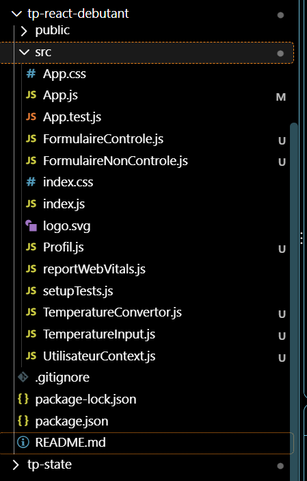
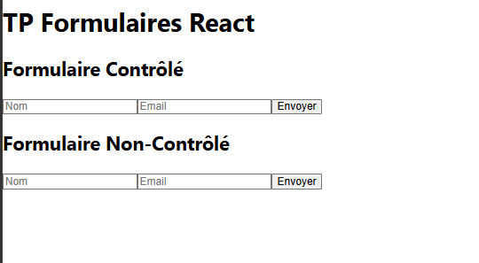
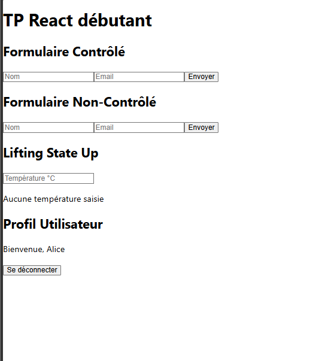

# TP 5 : Découvrir la gestion de l’état et la structuration des composants React

## 1. Objectif du TP

L’objectif de ce TP est de découvrir la gestion de l’état et la structuration des composants avec React. Il permet de comprendre les formulaires contrôlés et non contrôlés, le partage de l’état entre les composants et l’utilisation du contexte pour partager les informations utilisateur.

## 2. Structure du projet

Cette capture présente la structure du projet React et les différents fichiers créés pour réaliser les exercices du TP.

## 3. Affichage des formulaires

Cette capture montre l’affichage initial de l’application avec un formulaire contrôlé et un formulaire non contrôlé, chacun contenant un bouton « Envoyer ».

4. Résultat final de l’application

Cette capture présente le résultat final du projet React. Elle regroupe les deux formulaires, le composant Lifting State Up, qui affiche « Aucune température saisie » lorsqu’aucune température n’est entrée, et le composant Profil Utilisateur, qui affiche un message de bienvenue pour Alice avec un bouton permettant de se déconnecter.

